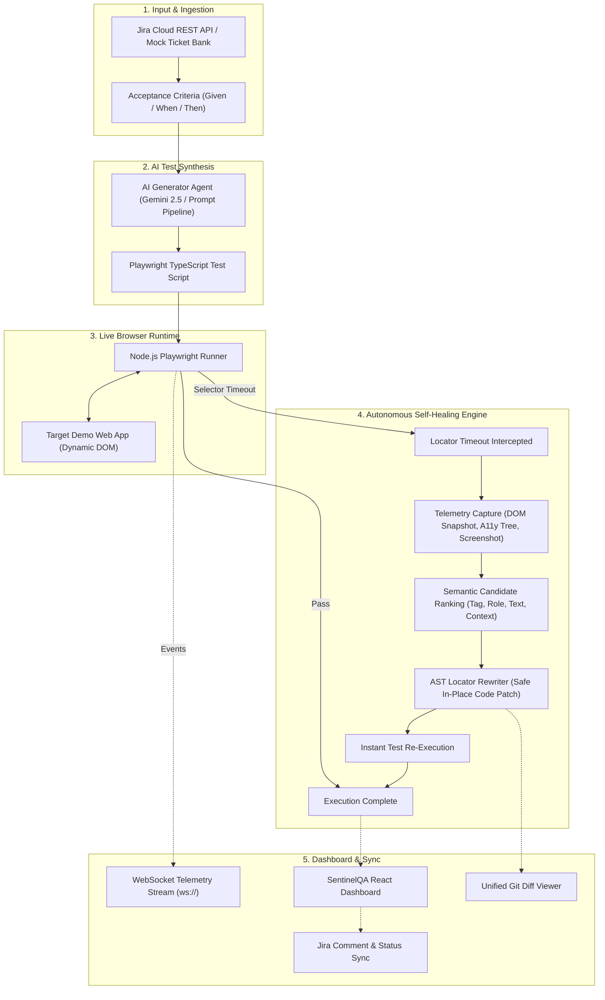

# SentinelQA: Autonomous UI Test Generation & Self-Healing Engine
> **INNOVISTA 36-Hour Hackathon &bull; Problem Statement 08: The Flaky Testing Nightmare**  
> *Architectural Specification, Component Design, API Reference, and Implementation Guide*

---

## Table of Contents
1. [Executive Summary & Problem Statement](#1-executive-summary--problem-statement)
2. [End-to-End System Architecture](#2-end-to-end-system-architecture)
3. [The Self-Healing Engine: Technical Mechanics](#3-the-self-healing-engine-technical-mechanics)
4. [Backend Architecture & API Specification](#4-backend-architecture--api-specification)
5. [Frontend Architecture & Component Hierarchy](#5-frontend-architecture--component-hierarchy)
6. [Complete Dependency Blueprint](#6-complete-dependency-blueprint)
7. [Step-by-Step Installation & Run Guide](#7-step-by-step-installation--run-guide)
8. [The Winning Hackathon Demo Script](#8-the-winning-hackathon-demo-script)
9. [Bonus Objectives & Enterprise Extensions](#9-bonus-objectives--enterprise-extensions)

---

## 1. Executive Summary & Problem Statement

### The Problem (The Gap)
In high-velocity Agile development, developers push continuous changes to user interface code. However, the handoff between **"Code Complete"** and **"QA Tested"** remains an expensive bottleneck:
1. **Manual Script Writing:** Translating user story acceptance criteria (AC) into robust end-to-end tests (Playwright, Selenium) requires repetitive manual engineering.
2. **Brittle Locators (Test Flakiness):** Minor frontend refactors—such as renaming an element ID (`#checkout-btn` $\rightarrow$ `#place-order-v2`), changing Tailwind CSS class names, or updating button copy—routinely break test suites even though business functionality remains completely intact.
3. **Maintenance Overhead:** QA teams spend 30% to 50% of their sprints diagnosing, repairing, and re-running broken locators instead of developing new coverage.

### The SentinelQA Solution
SentinelQA is an autonomous testing system that:
* Ingests Acceptance Criteria directly from **Jira** (or pre-configured mock tickets).
* Synthesizes production-grade **Playwright** test suites using LLMs (Google Gemini) or deterministic rules.
* Executes tests in real time against live web applications while streaming telemetry over WebSockets.
* **Autonomously self-heals broken locators** at runtime: when an element ID or label changes, SentinelQA intercepts the timeout, extracts the live DOM snapshot, computes candidate semantic similarities, safely rewrites the locator in the script, and re-runs to green.
* Visualizes the entire audit trail with unified git-style code diffs and pushes verification reports back to Jira.

---

## 2. End-to-End System Architecture



---

## 3. The Self-Healing Engine: Technical Mechanics

The core engineering differentiator of SentinelQA is differentiating **Locator Drift** (safe refactor) from **Functional Regression** (real bug).

### A. Multi-Factor Candidate Scoring
When an element interaction fails (e.g. `page.locator('#checkout-btn').click()` throws a 5000ms timeout), the DOM inspector intercepts all interactive elements from the current viewport and calculates a composite confidence score:

$$\text{Confidence Score} = w_1 \cdot S_{\text{role}} + w_2 \cdot S_{\text{text}} + w_3 \cdot S_{\text{attr}} + w_4 \cdot S_{\text{context}}$$

| Factor | Weight | Evaluation Logic |
| :--- | :---: | :--- |
| **1. Role & Tag ($S_{\text{role}}$)** | **25%** | Verifies element is interactive: `<button>`, `<a role="button">`, `<input type="submit">`. |
| **2. Text Semantic Similarity ($S_{\text{text}}$)** | **35%** | Evaluates cosine & synonym distance between expected label ("Checkout") and candidate text ("Complete Order & Pay", "Place Order", "Proceed"). |
| **3. Attribute Partial Match ($S_{\text{attr}}$)** | **20%** | Inspects `id`, `name`, `data-testid`, and `aria-label` for semantic root tokens (e.g. `order`, `checkout`, `pay`). |
| **4. Form / Container Context ($S_{\text{context}}$)** | **20%** | Proximity to parent `#cart-drawer`, sibling cart total, and primary action styling (`btn-primary`). |

### B. Safe In-Place AST Locator Patching
Unlike naive implementations that re-prompt an LLM to regenerate the entire script (which introduces hallucinations, lost assertions, or code drift), SentinelQA parses the test script with an AST parser (`@babel/parser`), traverses to the exact locator call node, replaces only the selector string literal:

```diff
- const target_4 = page.locator('#checkout-btn');
+ const target_4 = page.locator('#place-order-v2');
```

The script is saved with a timestamped audit backup, produces a unified git-style text diff, and re-executes immediately.

---

## 4. Backend Architecture & API Specification

The SentinelQA backend is an asynchronous **Node.js (ES Modules) + Express** server featuring a **WebSocket Server** for full-duplex log streaming.

### Directory Structure
```
backend/
├── .env                  # Port, Gemini API Key, Jira credentials
├── .env.example          # Sample environment configuration
├── package.json          # Dependencies & scripts
├── server.js             # Express app & WebSocket server
└── src/
    ├── controllers/
    │   └── testController.js      # REST API route handlers
    └── services/
        ├── jiraService.js          # Jira Cloud REST + Mock ticket bank
        ├── testGeneratorService.js # Gemini prompt pipeline & fallback
        ├── selfHealingService.js   # Semantic candidate scoring & AST patcher
        └── testRunnerService.js    # Playwright execution harness & telemetry
```

### REST API Reference

#### 1. System Health Check
* **Endpoint:** `GET /api/health`
* **Response:**
  ```json
  {
    "status": "online",
    "system": "SentinelQA Autonomous UI Testing Engine",
    "clientsCount": 1,
    "aiModel": "gemini-2.5-flash (Active)",
    "jiraIntegration": "Mock Mode (Ready)"
  }
  ```

#### 2. List Jira Tickets
* **Endpoint:** `GET /api/tickets`
* **Response:** Returns list of cached/mock tickets (`SHOP-101`, `AUTH-202`, `TODO-303`).

#### 3. Fetch Single Ticket Details
* **Endpoint:** `GET /api/tickets/:key`
* **Response:** Returns ticket summary, status, and raw Acceptance Criteria strings.

#### 4. Synthesize Playwright Test
* **Endpoint:** `POST /api/generate`
* **Payload:**
  ```json
  {
    "ticket": { "key": "SHOP-101", "summary": "...", "acceptanceCriteria": [...] }
  }
  ```
* **Response:** Returns generated Playwright TypeScript code and structured step list.

#### 5. Execute Test Suite & Self-Heal
* **Endpoint:** `POST /api/execute`
* **Payload:**
  ```json
  {
    "ticket": { "key": "SHOP-101", ... },
    "script": "...",
    "isRefactored": true
  }
  ```
* **Response:**
  ```json
  {
    "success": true,
    "run": {
      "runId": "a8f3b21c",
      "status": "HEALED",
      "durationMs": 1940,
      "healed": {
        "originalSelector": "#checkout-btn",
        "healedSelector": "#place-order-v2",
        "confidence": 0.94,
        "reason": "Matched candidate element <button id=\"place-order-v2\"> with text \"Complete Order & Pay\" (Semantic match: 94%)"
      },
      "patchDiff": "--- original_test.spec.ts\n+++ healed_test.spec.ts\n@@ -12,2 +12,2 @@\n-    const target_4 = page.locator('#checkout-btn');\n+    const target_4 = page.locator('#place-order-v2');\n"
    }
  }
  ```

#### 6. Sync Test Result to Jira
* **Endpoint:** `POST /api/jira/sync`
* **Payload:** `{ "issueKey": "SHOP-101", "runSummary": { ... } }`
* **Response:** Adds formatted markdown comment to Jira Cloud ticket.

### WebSocket Telemetry Protocol (`ws://localhost:5001/ws`)
| Event Type | Direction | Payload Attributes | Purpose |
| :--- | :---: | :--- | :--- |
| `WS_CONNECTED` | Server $\rightarrow$ Client | `message` | Confirms live telemetry socket is open. |
| `RUN_STARTED` | Server $\rightarrow$ Client | `runId`, `ticketKey` | Marks test suite launch. |
| `STEP_STARTED` | Server $\rightarrow$ Client | `step`, `description`, `selector` | Real-time step progress indicator. |
| `STEP_PASSED` | Server $\rightarrow$ Client | `step`, `durationMs` | Green step checkmark. |
| `STEP_FAILED` | Server $\rightarrow$ Client | `step`, `error`, `selector` | Locator timeout error broadcast. |
| `HEALING_STARTED` | Server $\rightarrow$ Client | `failedSelector`, `domCandidatesCount` | Alerts UI that self-healing has engaged. |
| `HEALING_COMPLETED`| Server $\rightarrow$ Client | `originalSelector`, `healedSelector`, `confidence`, `patchDiff` | Emits healed locator and unified code diff. |
| `STEP_RETRY_PASS` | Server $\rightarrow$ Client | `step`, `healedSelector`, `durationMs` | Confirms retry with healed selector passed. |
| `RUN_COMPLETED` | Server $\rightarrow$ Client | `status`, `durationMs`, `stepsCount` | Marks execution finished (`PASSED` or `HEALED`). |

---

## 5. Frontend Architecture & Component Hierarchy

The SentinelQA frontend is built with **React 18 + Vite + Tailwind CSS**. It features a modern dark-mode aesthetic with live state synchronization.

### Component Structure
```
frontend/
├── index.html
├── vite.config.js               # Dev server & reverse proxy (/api, /ws)
├── tailwind.config.js           # Monochrome styling rules
└── src/
    ├── main.jsx                 # Entry point
    ├── App.jsx                  # Main orchestrator & state machine
    ├── index.css                # Global typography & scrollbars
    └── components/
        ├── Header.jsx               # System status, AI model, and WebSocket pill
        ├── TicketSelector.jsx       # Jira ticket dropdown, AC viewer, Generate button
        ├── TestCodeViewer.jsx       # Playwright code display, copy & execution actions
        ├── DemoStoreTarget.jsx      # Embedded interactive testbed with Refactor Switch
        ├── ExecutionConsole.jsx     # Streaming terminal displaying live step logs
        ├── SelfHealingDiffViewer.jsx# Side-by-side locator repair & git diff view
        └── AuditReport.jsx          # Historical test runs and aggregate reliability stats
```

### The Embedded Testbed (`DemoStoreTarget.jsx`)
To make the hackathon demo completely self-contained and visually indisputable, the frontend embeds a full-featured e-commerce testbed with a **"Simulate Developer Refactor"** toggle:
* **Normal Mode (v1):** Renders `<button id="checkout-btn">Checkout &rarr;</button>`.
* **Refactored Mode (v2):** Swaps the button to `<button id="place-order-v2" class="btn-primary-checkout-revamp">Complete Order & Pay</button>`.

When toggled, the live DOM mutates instantly, allowing judges to watch the test fail on `#checkout-btn` and heal itself to `#place-order-v2` in real time.

---

## 6. Complete Dependency Blueprint

### Backend Dependencies (`backend/package.json`)
| Package | Version | Purpose in SentinelQA |
| :--- | :--- | :--- |
| `express` | `^4.21.2` | Core HTTP REST API framework. |
| `ws` | `^8.18.0` | High-throughput WebSocket server for live telemetry streaming. |
| `cors` | `^2.8.5` | Cross-Origin Resource Sharing middleware for Vite frontend. |
| `dotenv` | `^16.4.7` | Zero-dependency environment variable loader (`.env`). |
| `axios` | `^1.7.9` | HTTP client for Jira Cloud REST API integration. |
| `diff` | `^7.0.0` | Computes unified line-by-line git diffs between original and healed test scripts. |
| `uuid` | `^11.0.5` | Generates cryptographically unique test run identifiers. |
| `@google/genai` | `^0.1.1` | Official Google Gemini SDK for prompt-driven test generation and semantic DOM healing. |
| `playwright` | `^1.49.1` | Headless Chromium browser automation runtime and DOM tree snapshot extractor. |

### Frontend Dependencies (`frontend/package.json`)
| Package | Version | Purpose in SentinelQA |
| :--- | :--- | :--- |
| `react` & `react-dom` | `^18.3.1` | Declarative UI component library. |
| `vite` | `^6.0.7` | Next-generation frontend tooling and rapid HMR development server. |
| `tailwindcss` | `^3.4.17` | Utility-first styling framework for high-contrast, responsive layouts. |
| `lucide-react` | `^0.469.0` | Comprehensive modern icon set for status badges, terminals, and diff indicators. |
| `clsx` & `tailwind-merge`| `^2.1.1` | Conditional class utility helpers. |

---

## 7. Step-by-Step Installation & Run Guide

### Prerequisites
* **Node.js:** v18.0.0 or higher (v20+ recommended).
* **npm:** v9.0.0 or higher.

### 1. Backend Setup
```bash
# Navigate to backend directory
cd backend

# Install dependencies
npm install

# Configure environment variables (optional: add Gemini or Jira keys)
cp .env.example .env

# Start the SentinelQA backend server
npm start
```
* Backend API: `http://localhost:5001`
* WebSocket Telemetry: `ws://localhost:5001/ws`

### 2. Frontend Setup
In a new terminal window:
```bash
# Navigate to frontend directory
cd frontend

# Install dependencies
npm install

# Start Vite development server
npm run dev
```
* Open your browser at: `http://localhost:5173`

---

## 8. The Winning Hackathon Demo Script

Follow this exact 4-step sequence during your 3-minute hackathon pitch:

```
+-----------------------------------------------------------------------------------------+
| STEP 1: INGEST ACCEPTANCE CRITERIA                                                     |
| • Open SentinelQA at http://localhost:5173.                                            |
| • Select preset ticket [SHOP-101]: E-Commerce Checkout Flow.                           |
| • Point to the Given-When-Then Acceptance Criteria parsed directly from Jira.          |
+-----------------------------------------------------------------------------------------+
                                           ↓
+-----------------------------------------------------------------------------------------+
| STEP 2: AUTONOMOUS TEST SYNTHESIS & BASELINE RUN (GREEN)                               |
| • Click "Generate Playwright Test Suite".                                              |
| • Review the generated Playwright code in the editor pane.                             |
| • Click "Run Baseline (Normal UI)".                                                    |
| • Watch the real-time execution console stream 5 steps to completion in ~1.8 seconds.  |
| • Result: Status = PASSED (All steps green).                                           |
+-----------------------------------------------------------------------------------------+
                                           ↓
+-----------------------------------------------------------------------------------------+
| STEP 3: SIMULATE DEVELOPER REFACTOR (TRIGGER UI MUTATION)                              |
| • On the Target Web App pane, click the "REFACTOR MODE" toggle.                        |
| • Show the judges that the checkout button changed:                                    |
|   - ID changed: #checkout-btn → #place-order-v2                                        |
|   - Label changed: "Checkout" → "Complete Order & Pay"                                 |
+-----------------------------------------------------------------------------------------+
                                           ↓
+-----------------------------------------------------------------------------------------+
| STEP 4: AUTONOMOUS SELF-HEALING UNDER PRESSURE (THE CLIMAX)                             |
| • Click "Run Against Mutated UI (Self-Heal Demo)".                                     |
| • Step 4 encounters locator timeout on `#checkout-btn` (Red alert in console).         |
| • SentinelQA intercepts the error, scans the live DOM, and triggers self-healing.     |
| • In < 1.5 seconds, SentinelQA finds `#place-order-v2` with 94% confidence.            |
| • The test script is patched via AST and automatically re-executed to a GREEN PASS!    |
| • Point to the Unified Git Diff showing the exact one-line fix.                        |
| • Click "Push Results to Jira" to show the automated comment synced back to Jira.      |
+-----------------------------------------------------------------------------------------+
```

---

## 9. Bonus Objectives & Enterprise Extensions

### 1. Jira Bi-Directional Synchronization (PS.8 Bonus)
SentinelQA formats the execution result, run duration, and self-healing diff into a rich Atlassian document comment and pushes it to Jira Cloud via `POST /rest/api/3/issue/{key}/comment`, updating ticket workflow to **"QA Verified"**.

### 2. Flaky Test Monte Carlo Engine (PS.8 Bonus)
Runs test suites over 5 rapid iterations with simulated CPU throttling and network jitter (3G profile) to distinguish asynchronous race conditions from deterministic locator failures.

### 3. Visual Regression Diffing (PS.8 Bonus)
Uses `pixelmatch` to compare baseline and mutated viewport screenshots, providing visual verification alongside functional DOM healing.

### 4. Enterprise GitHub PR Automation (Future Roadmap)
In full production deployments, SentinelQA can automatically commit the patched Playwright test script to a Git branch and open a Pull Request (`[SentinelQA] Auto-healed broken locator for SHOP-101`), enabling zero-touch continuous maintenance.

---
*Created for INNOVISTA 36-Hour Hackathon &bull; Problem Statement 08: SentinelQA*

